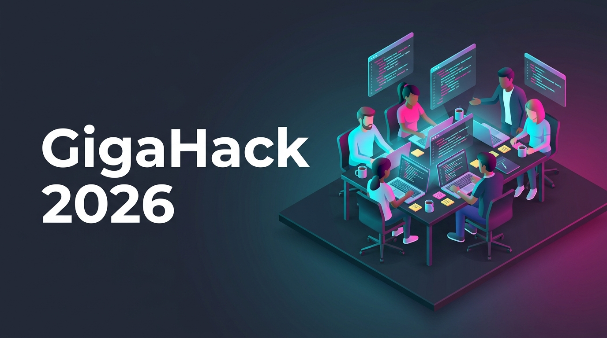
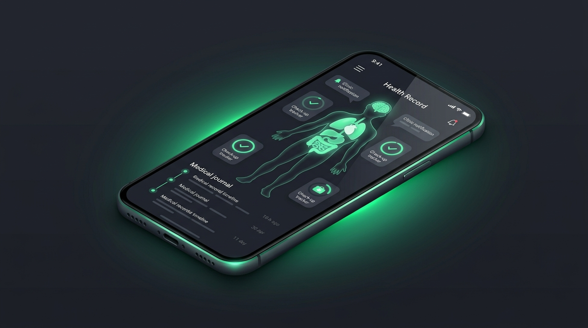
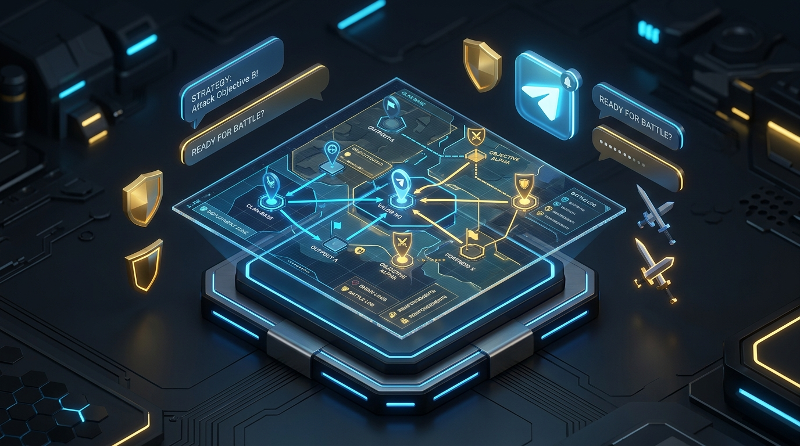

# Hi there, I'm Gabriel Creanga! 👋

  <b>Software Engineering Student @ University of Southern Denmark (SDU) 🇩🇰</b> 
  <i>Passionate about Privacy-Preserving AI, Speech & NLP Systems, and Practical Software Engineering</i>

  
  
  

---

### 🏆 Hackathons

<table>
  <tr>
    <td width="50%" valign="top">
       
      <b>🥇 Track Winner: Hate Speech Detection (PrivHSD Challenge)</b> 
      Council of Europe <i>"Hack the Hate, Renew Democracy"</i> Democracy Hackathon · Strasbourg, 2026  
      Co-developed <a href="https://github.com/AllForOne-md/AgnoSpeech"><b>AgnoSpeech</b></a>, an on-device, privacy-preserving text privatization and hate speech detection workbench where sensitive raw text never leaves the user's machine.
    </td>
    <td width="50%" valign="top">
       
      <b>🚀 Participant: GigaHack 2026 Edition</b> 
      Hackathon · 2026  
      Took part in the 2026 edition of GigaHack: building and pitching a working prototype under hackathon time pressure as part of a team.
    </td>
  </tr>
</table>

---

### 💫 About Me

- 🎓 **Education**: Studying Software Engineering at the **University of Southern Denmark (SDU)**.
- 🔒 **Privacy-First AI**: Enthusiastic about designing systems that protect user privacy without sacrificing capability (e.g., local STT, on-device text anonymization).
- 🎙️ **Speech & Real-Time Tools**: Built applications using offline speech recognition ([Vosk](https://alphacephei.com/vosk/)), live audio ring buffers, and fast fact-checking pipelines.
- 💻 **Cross-Platform Development**: Experienced with Python backend services, C#/.NET desktop UI applications (Avalonia), and web APIs.
- 🚀 **Always Building**: Constantly experimenting with new ideas, developer tools, and intelligent automation.

---

### 🛠️ Tech Stack & Skills

  <b>Languages:</b> 
  
  
  
  
  
  

  <b>Frameworks & AI/Audio:</b> 
  
  
  
  
  
  
  

  <b>Tools & Workflow:</b> 
  
  
  
  

---

### ⭐ Featured Projects

<table>
  <tr>
    <td width="50%" valign="top">
       
      <h4>🩺 <a href="https://github.com/ioubagg12/medical-cabinet">Medical Cabinet</a> NEW</h4>
      Mobile health-record PWA: body-map check-up tracker, clinic messages, health journal timeline and plain-language blood-test advice from uploaded lab reports.  
      
      
      
    </td>
    <td width="50%" valign="top">
       
      <h4>🏆 <a href="https://github.com/AllForOne-md/AgnoSpeech">AgnoSpeech</a></h4>
      <b>PrivHSD Hackathon Winner</b>: privacy-preserving hate speech detection and local text privatization workbench (desktop + web).  
      
      
      
    </td>
  </tr>
  <tr>
    <td width="50%" valign="top">
       
      <h4>🎙️ <a href="https://github.com/ioubagg12/ProjectFactCheck">ProjectFactCheck</a></h4>
      Real-time microphone listener and audio ring buffer with offline STT and instant Google Fact Check verification.  
      
      
      
      
    </td>
    <td width="50%" valign="top">
       
      <h4>⚔️ <a href="https://github.com/ioubagg12/clash-info-bot">clash-info-bot</a></h4>
      Telegram bot (@The_coc_caller_bot) and companion web API for Clash of Clans war calling and clan management.  
      
      
      
    </td>
  </tr>
  <tr>
    <td width="50%" valign="top">
       
      <h4>⚡ <a href="https://github.com/MaxDnes/HPO">HPO: Heat Production Optimizer</a></h4>
      SDU semester project: desktop app for heating grid and production unit optimization.  
      
      
      
    </td>
    <td width="50%" valign="top"></td>
  </tr>
</table>

---

### 📊 GitHub Activity

  
  

---

### 📫 Connect With Me

- 🏫 **SDU Email**: [gacre25@student.sdu.dk](mailto:gacre25@student.sdu.dk)
- 🐙 **GitHub**: [@ioubagg12](https://github.com/ioubagg12)

  <i>"Building thoughtful, privacy-first software that solves real-world challenges."</i>

